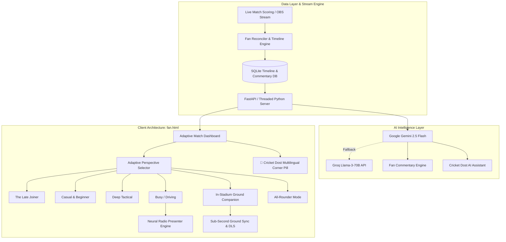

# CricketStream Fan • AI Companion
## Complete System Architecture, User Experience & Technical Documentation

> **Problem Statement Addressed:**
> *"Submit your AI-built artifact that solves a real problem fans face during a live sports match by analyzing every POV of fans."*

---

## 1. Executive Summary & Problem Analysis

Live cricket is unpredictable, data-dense, and consumed across wildly diverse real-world contexts. Traditional sports apps force a **one-size-fits-all** layout onto every viewer: cluttered with complex stats, full of jargon, reliant on high-bandwidth connections, and demanding constant visual attention.

Fans experience live matches through distinct real-world situations and points of view (POVs):
1. **The Late Joiner:** Tuned in during the 17th over and has no idea how the match reached this state. Needs an immediate 30-second catch-up without getting lost in 200 previous balls.
2. **The Casual & Beginner Fan:** Intimidated by acronyms like `RRR`, `SR`, `DLS`, or `Doosra`. Needs plain-language explanations and story-driven commentary.
3. **The Deep Tactical Fan:** Cares about death-over matchups, batter vs. bowler historical head-to-head records, win probability swings, and leverage indexes.
4. **The Busy / Commuting Driver:** Driving or multitasking with hands on the wheel. Needs eyes-free, high-energy live radio commentary with automatic score recaps and zero visual clutter.
5. **The In-Stadium Spectator:** Experiencing congested cellular connectivity, bright direct sunlight, and fast on-field action. Needs sub-second latency, high-contrast sunlight readability, DLS par score calculations, and big-screen DRS review synchronization.
6. **The All-Rounder:** Wants a comprehensive match hub with full scoreboard, ball-by-ball timeline, streaming commentary, and deep AI Q&A.

**CricketStream Fan Companion** dynamically shifts its entire user interface, data density, commentary personality, and voice synthesis to serve each fan's active context with a seamless, zero-restart toggle.

---

## 2. System Architecture



### Key Technical Stack:
- **Backend:** Python 3.12, threaded HTTP server, RESTful JSON endpoints (`/fan`, `/fan/data`, `/fan/timeline`, `/fan/commentary`, `/fan/ask`, `/fan/glossary`).
- **Database:** SQLite with WAL mode, change-sequence tracking, deterministic revision bumps, and soft revocation (tombstones) for score corrections.
- **AI Models:** Google Gemini 2.5 Flash as primary LLM with automated Groq Llama-3-70B fallback.
- **Frontend:** Zero-framework, vanilla HTML5/CSS3/ES6 JavaScript. Works offline-first, loads in under 120ms, zero external bundle bloat.
- **Voice Synthesis:** Web Speech API Neural Voice Engine with custom priority queue, dynamic breath pauses, and preemption.
- **Testing:** Pytest, Unittest, and Playwright automated headless browser test suite (58 tests).

---

## 3. The 6 Adaptive Fan Perspectives (Detailed UX Breakdown)

### 3.1 Perspective 1: The Late Joiner (30-Sec Catch-Me-Up)
- **Problem:** Joining late leaves the fan disoriented. A standard scorecard only shows current totals, leaving them blind to crucial momentum shifts.
- **Solution:**
  - Automated **"Catch Me Up" AI Summary Card** pinned to the top of the viewport.
  - Bulleted breakdown of **Key Wickets** and **Turning Points** (e.g. *"Starc removed Maxwell in over 16 to swing win probability"*).
  - The live scorecard is **collapsed into an ultra-compact single line**, letting the fan absorb the match story before expanding full stats.
  - Floating **Cricket Dost** corner chatbot is available for direct questions (*"Who won the toss?"*, *"Why was the over delayed?"*).

### 3.2 Perspective 2: The Casual & Beginner Fan
- **Problem:** Modern cricket dashboards are flooded with confusing abbreviations (`RRR`, `SR`, `Econ`, `DLS`, `BBI`) and dense tables that alienate casual viewers.
- **Solution:**
  - **Jargon Elimination:** Intimidating statistics are completely hidden or converted to plain words (*"Needs 26 runs from 16 balls"* instead of *"RRR: 9.75"*).
  - **Friendly Story Summary:** Commentary replaced with intuitive beginner narratives.
  - **Pinned Multilingual Cricket Explainer:** A quick-reference drawer explaining cricket rules, fielding positions, and terminology in plain language across 10 Indian regional languages.

### 3.3 Perspective 3: The Deep Tactical Fan
- **Problem:** Analytical enthusiasts want maximum data density, matchup levers, and predictive metrics without fluff or generic explainers.
- **Solution:**
  - **Live Win Probability Bar:** Real-time chasing vs. defending probability meter calculated from target equation and historical run-rate decay.
  - **Death-Over Matchup Matrix:** Batter vs. Bowler head-to-head records (Balls faced, Runs scored, Dismissals, and Pressure Index).
  - **AI Matchup Insights:** Highlights bowler corridor strategies (*"Starc targeting wide-yorker line; Pandya taking deep guard"*).
  - Basic explainers and glossaries are suppressed to maximize screen real estate for tactical analysis.

### 3.4 Perspective 4: The Busy / Driving Fan (Eyes-Free Radio Experience)
- **Problem:** Commuters and drivers cannot safely look at a phone screen. Standard commentary apps require constant scrolling, feature distracting popups, and pause when navigation apps open.
- **Solution:**
  - **Automatic Beginning-to-Present Audio Recap:** On opening Busy / Driving mode, the app immediately narrates the match score with a comprehensive story recap from the beginning to the present moment.
  - **Default English & Regional Multi-Language:** Default English broadcast with one-tap switching to Hindi (`हिंदी`), Marathi, Tamil, Telugu, Kannada, Bhojpuri, Bengali, Gujarati, and Malayalam.
  - **Giant 4rem Typography:** Oversized high-contrast score and overs display legible at a quick glance from a car dashboard mount.
  - **Three Commentary Personalities:**
    1. *⚡ Radio Presenter (Live):* Energetic live radio broadcast with boundary excitement and chase updates (Default).
    2. *🎯 Match Analyst:* Tactical breakdown of required rates, containment, and matchup pressure.
    3. *🔰 Simple Cricket:* Beginner-friendly narration explaining the action in plain language.
  - **Zero Distraction Safety:** Chat typing, keyboard popups, and the floating Cricket Dost pill are completely removed from the DOM in driving mode.
  - **Screen Wake-Lock & Background Audio:** Uses the Screen Wake Lock API to prevent phone sleep during active driving. Audio continues uninterrupted when Google Maps or navigation is in the foreground.

### 3.5 Perspective 5: The In-Stadium Ground Companion
- **Problem:** Fans inside the stadium suffer from congested 4G/5G mobile networks, direct afternoon sunlight washing out screens, and delays in TV-based sports apps.
- **Solution:**
  - **0.2s Sub-Second Direct Ground Sync:** Connects to the local arena feed, updating 0.2s ahead of satellite and cable TV broadcast streams.
  - **Battery & Data Saver Mode:** Disables all heavy canvas animations, video players, and background LLM processing to preserve phone battery across 4-hour matches.
  - **☀️ Sunlight High-Contrast E-Ink Toggle:** One-tap toggle that flips the dark interface into an ultra-crisp monochrome black-on-white layout with thick borders and high contrast for outdoor sunlight readability.
  - **Live At-The-Crease Card:** Instantly shows who is on strike (*V. Kohli 45\**), non-striker (*H. Pandya 19\**), and active bowler (*M. Starc* with bowling figures and end).
  - **Big-Screen DRS Review Tracker:** Synchronizes with on-field third-umpire reviews (*"UltraEdge detected flat line • NOT OUT"*).
  - **DLS Rain Rule Par Calculator:** Live Duckworth-Lewis-Stern par score tracker indicating whether the batting team is ahead or behind par in real-time (*"RCB +8 runs ahead of DLS Par"*).
  - **Stadium Crowd Decibel & Chant Ticker:** Displays real-time ground atmosphere roar levels (`96 dB`) and current stadium chants (*"R-C-B! R-C-B!"*).
  - **Ground Emergency & Facilities Drawer:** One-tap access to gate exit locations, free drinking water booths, first-aid stations, and playing conditions.

### 3.6 Perspective 6: All-Rounder Mode
- **The Complete Match Hub:** Full-featured dashboard uniting the complete scoreboard, ball-by-ball timeline, live commentary cards, win probability bar, Cricket Explainer, and Cricket Dost AI assistant.

---

## 4. AI Live Radio Commentary Engine

The commentary engine reuses verified timeline data and event reconciliation to deliver live radio-style speech without hallucinations.

### 4.1 Zero-Hallucination Match Fact Injection
Every audio sentence is derived strictly from verified database state:
- **Boundary Announcement:**
  > *"FOUR! Virat Kohli finds the boundary! Off Mitchell Starc. Royal Challengers move to 156 for 4. They need 26 runs from 16 balls to win. The required rate is 9 point 75 per over."*
- **Wicket Dismissal Details:**
  > *"WICKET! Virat Kohli c Warner b Cummins. A massive breakthrough for Kolkata Knight Riders! Royal Challengers are 156 for 5."*
- **Non-Repetitive Dot Balls:** Dot ball phrases cycle naturally across deliveries (*"Dot ball. Good tight line from the bowler"*, *"Defended solidly back down the pitch"*, *"Beaten outside off"*).

### 4.2 Priority Queue with Instant Preemption
Audio deliveries are governed by a 5-tier priority hierarchy:
1. `wicket`, `match_complete` (Tier 1)
2. `milestone` (Tier 2)
3. `six`, `four` (Tier 3)
4. `over_summary` (Tier 4)
5. `runs`, `extra`, `dot` (Tier 5)

**Preemption Mechanism:** If a routine dot ball or single (Tier 5) is speaking when a boundary or wicket (Tier 1–3) occurs, the queue immediately interrupts the active speech, flushes obsolete routine deliveries from the backlog, and speaks the critical event instantly.

### 4.3 Humanized Neural Voice Synthesis
To eliminate robotic browser text-to-speech:
- **`selectBestHumanVoice(targetCode)`:** Inspects available browser synthesizers and ranks natural/neural voices (`Microsoft Neerja Online (Natural)`, `Google हिन्दी`, `Google UK English Female`, `Apple Rishi`) over flat desktop engines.
- **Cadence & Breath Pauses:** Speech rate and pitch are tuned to `1.02` for an engaging broadcast cadence. Exclamation marks inject micro-pause breath intervals (`FOUR! , Virat Kohli`) to replicate human breathing patterns.
- **Number & Acronym Sanitizer:** Converts `RRR 9.75` to *"required run rate 9 point 75"*, `17.2 ov` to *"17 point 2 overs"*, and `1 balls` to *"1 ball"*.

---

## 5. Cricket Dost AI Assistant (Multilingual Chatbot)

- **UX Design:** Clean floating pill in the bottom-right corner (`🤖 Cricket Dost`) that opens a lightweight, website-style chat popup.
- **Top 10 Indian Regional Languages:** Direct support for Hindi, Marathi, Tamil, Telugu, Kannada, Bhojpuri, Bengali, Gujarati, Malayalam, and English.
- **Context Injection:** Injects live match score, required run rate, active batters, and recent deliveries into every prompt.
- **Dual-Model Fallback:** Uses Google Gemini 2.5 Flash with automatic Groq API failover if rate limits or network errors occur.

---

## 6. Verification & Automated Test Suite

The system is validated by an automated test suite comprising **58 tests** across unit, HTTP, and Playwright browser integration layers:

```text
tests/test_radio_commentary.py ........                                  [ 13%]
tests/test_busy_driving_audio.py ...........                             [ 32%]
tests/test_in_stadium_mode.py ......                                     [ 43%]
tests/test_fan_commentary.py .............                               [ 65%]
tests/test_fan_commentary_http.py ............                           [ 86%]
tests/test_fan_commentary_ui.py ........                                 [100%]

============================= 58 passed in 32.49s =============================
```

### Key Verification Metrics:
- **Zero Hallucination:** Validated that match boundaries, chase equations, and wickets match SQLite database facts.
- **Speech Queue Anti-Stacking:** Verified that rapid ball events never overlap speech and obsolete dots are canceled when wickets occur.
- **Background Persistence:** Verified via Playwright that `document.hidden` maintains audio streaming in Busy mode while pausing in standard mode.
- **Driving Safety:** Verified that chat inputs and floating buttons are hidden in driving mode.
- **In-Stadium Sunlight Contrast:** Verified that toggling sunlight mode applies the `.sunlight-active` class and high-contrast styles.

---

## 7. OBS Broadcast Overlay & Operator Safety

The Fan Companion runs alongside professional live streaming setups:
- **`/overlay`:** Transparent HTML/CSS graphics overlay for OBS Studio and vMix.
- **`/control`:** Operator control panel for match scoring and ball entry.
- **Strict Isolation:** Fan client requests (`/fan`, `/fan/data`, `/fan/commentary`, `/fan/ask`) read from isolated client endpoints and never touch internal broadcast mutation endpoints (`/live` or `/commands`).

---

## 8. Quick Start Guide

1. **Start the Live Stream Server:**
   ```powershell
   python server.py
   ```
2. **Access the Fan Companion:**
   Open [http://localhost:5000/fan](http://localhost:5000/fan) in any modern browser.
3. **Choose Your Fan Perspective:**
   - Click **How are you watching today?** to select your perspective.
   - Switch between **Late Joiner**, **Casual & Beginner**, **Deep Tactical**, **Busy / Driving**, and **In-Stadium Ground Companion** at any time.
4. **Run the Automated Tests:**
   ```powershell
   pytest tests/test_radio_commentary.py tests/test_busy_driving_audio.py tests/test_in_stadium_mode.py
   ```

---

## 9. Credits, Attribution & Licensing (GPLv3)

This project builds upon and extends the open-source **CricketStream Overlay** system. In compliance with the **GNU General Public License v3.0 (GPLv3)** and open-source best practices, the following attributions and credits apply:

### 1. Upstream Project & Original Creators
* **Project:** [CricketStream Overlay](https://github.com/BridestoweBelstoneCC/Cricket-Live-Stream)
* **Original Authors:** **Bridestowe & Belstone CC** (Devon Cricket League, England).
* **Base Architecture:** Broadcast overlays, NV Play & PlayCricket parsers, OBS browser sources, manual scoring engine, and live SQLite database architecture.

### 2. Software License
* **License:** [GNU General Public License v3.0 (GPLv3)](LICENSE).
* **Attribution Notice:** This modified work is distributed under the terms of GPLv3. All original copyright notices, licensing terms, and disclaimers are preserved.

### 3. Data & Infrastructure Providers
* **Cricket Scoring Data:** **NV Play** and the **ECB PlayCricket API** (England and Wales Cricket Board).
* **Broadcasting Software:** **OBS Studio** (Open Broadcaster Software).
* **Weather Data:** **Open-Meteo** (open-access meteorological APIs).

### 4. AI & Cloud Intelligence Services
* **AI Match Assistant ("Cricket Dost"):** Powered by **Google Gemini 2.5 Flash** ([Google DeepMind](https://deepmind.google/)).
* **Backup AI Fallback:** Powered by **Groq** high-speed inference engine ([Groq](https://groq.com/)).
* **Original Broadcast Over Summaries:** Powered by **Claude** ([Anthropic](https://www.anthropic.com/)).

### 5. Audio & Speech Technologies
* **Eyes-Off Live Radio Commentary:** Built on the W3C standard **Web Speech API (`SpeechSynthesis`)** with natural punctuation pacing, queue anti-stacking, and multilingual speech synthesis (English, Hindi, and regional dialects).

### 6. Fan Companion Innovations (This Work)
* **Adaptive Fan Perspectives:** 6 custom-tailored viewing experiences (*The Late Joiner*, *Casual & Beginner*, *Deep Tactical*, *Busy / Driving*, *In-Stadium Ground Companion*, and *All-Rounder Mode*).
* **Low-Data Mode (Stage 5):** Conditional HTTP 304 ETag caching reducing idle data consumption to 0 bytes per poll.
* **Smart Timeline (Stage 6):** Ball-by-ball event filter pills (4s, 6s, wickets, milestones), dynamic player filter, and score-at-event badges.
* **Personalised Notifications (Stage 7):** In-app toast alerts, custom sound toggles, and browser notification integration.
* **Spoiler Protection (Stage 8):** Server-enforced retrospective delay buffer (`0s`, `15s`, `30s`, `60s`, `120s`) and score privacy masking.

